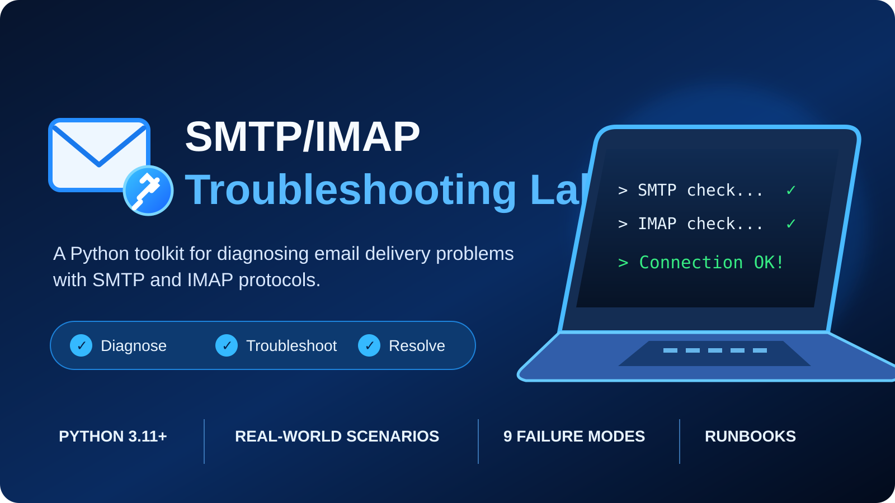
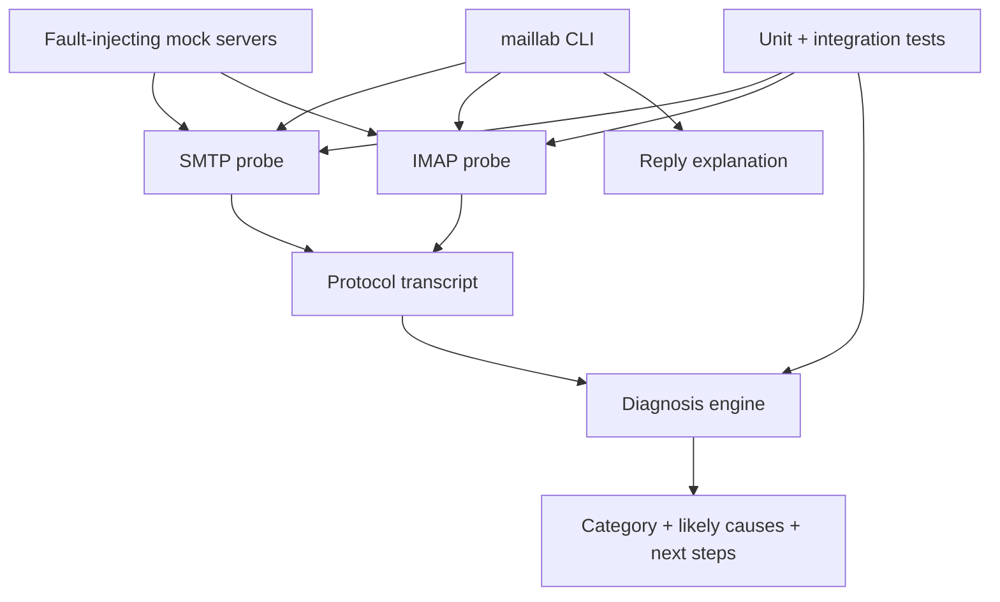

<div align="center">



# MailLab — SMTP / IMAP Troubleshooting Lab

**An evidence-first email protocol diagnostics toolkit for support engineers.**

[](https://github.com/sajidmanzoor730/smtp-imap-troubleshooting-lab/actions/workflows/ci.yml)
[](https://www.python.org/)
[](pyproject.toml)
[](LICENSE)

[Quick start](#quick-start) · [Capabilities](#capabilities) · [Architecture](docs/architecture.md) · [Lab exercises](docs/lab-guide.md) · [Runbook](docs/runbook.md) · [Security](SECURITY.md)

</div>

---

## What is MailLab?

MailLab is a Python command-line toolkit and repeatable troubleshooting lab for investigating SMTP submission and IMAP mailbox-access failures. It follows a practical L2 support workflow: **reproduce the symptom, identify the failing protocol stage, classify the evidence, and choose the next diagnostic action.**

It is designed for engineers who need to distinguish DNS and network reachability problems from TLS negotiation, authentication, mailbox access, SMTP relay policy, and temporary server failures.

> **Scope:** MailLab performs protocol connectivity and authentication checks. Its SMTP envelope probe stops after `RCPT TO` and sends `RSET`; it does not submit a message body. A successful probe is not proof of inbox delivery.

## Capabilities

| Area | What it does |
|---|---|
| SMTP diagnostics | Connect, read banner, EHLO, STARTTLS or implicit TLS, AUTH, optional envelope check, QUIT |
| IMAP diagnostics | Connect, CAPABILITY, optional STARTTLS, LOGIN or XOAUTH2, read-only mailbox selection |
| TLS inspection | Uses certificate verification by default and records negotiated TLS version |
| Authentication | SMTP AUTH LOGIN, SMTP/IMAP XOAUTH2, optional OAuth2 refresh-token exchange |
| Failure classification | Maps SMTP reply codes, enhanced status codes, IMAP auth responses and socket/TLS errors to likely causes and next steps |
| Safe reproduction | Local fault-injecting mock servers for common success and failure paths |
| Automation | Human-readable and JSON output, meaningful process exit codes, CI test matrix |
| Support documentation | Runbooks, Wireshark filters, DNS/email-authentication checklist, case study and lab exercises |

### Diagnostic coverage

| Layer | Example symptom | MailLab response |
|---|---|---|
| DNS / TCP | Name lookup failure, refused connection, timeout | Network diagnosis and reachability checks |
| SMTP greeting | `421`, malformed or missing banner | Transient/protocol diagnosis |
| TLS | STARTTLS missing, `454`, certificate failure, handshake reset | TLS diagnosis and capture guidance |
| Authentication | `535`, AUTH not advertised, XOAUTH2 rejected | Authentication diagnosis |
| SMTP policy | `554 5.7.1` relay denied | Policy diagnosis |
| Temporary rejection | `451 4.7.1` greylisting | Transient diagnosis and retry guidance |
| IMAP | Authentication failure, unavailable service, mailbox selection | IMAP-specific diagnosis and read-only verification |

## Quick start

### 1. Install

Requires Python 3.11 or later. Runtime uses only the Python standard library.

```bash
git clone https://github.com/sajidmanzoor730/smtp-imap-troubleshooting-lab.git
cd smtp-imap-troubleshooting-lab
python -m pip install -e .
maillab --version
```

### 2. Explain a server reply

```bash
maillab explain 454 "4.7.0 TLS not available due to temporary reason"
maillab explain 535 "5.7.8 Authentication credentials invalid" --json
```

### 3. Run a local failure simulation

Terminal 1 — start a mock SMTP server:

```bash
maillab mock smtp --mode starttls_unavailable --port 2525
```

Terminal 2 — run the diagnostic probe:

```bash
maillab smtp 127.0.0.1 --port 2525 --mode starttls --json
```

Expected result: the TCP connection and SMTP greeting succeed, but STARTTLS is refused with `454`. MailLab classifies the failure as TLS-related and returns a non-zero exit code.

### 4. Probe an authorised SMTP server

Use a test account and provide credentials through environment variables—not command-line arguments:

```bash
export MAILLAB_PW='replace-with-test-app-password'
maillab smtp smtp.example.test \
  --port 587 --mode starttls \
  --user test-user@example.test \
  --password-env MAILLAB_PW
unset MAILLAB_PW
```

### 5. Probe IMAP over implicit TLS

```bash
export MAILLAB_PW='replace-with-test-app-password'
maillab imap imap.example.test \
  --port 993 --mode ssl \
  --user test-user@example.test \
  --password-env MAILLAB_PW
unset MAILLAB_PW
```

Mailbox selection is read-only (`EXAMINE` semantics). Do not use credentials for accounts you do not own or administer.

## Example diagnostic output

A STARTTLS refusal from the local mock is reported in a structured sequence:

```text
SMTP probe 127.0.0.1:2525 (starttls)

[ok  ] tcp connect
[ok  ] banner
[ok  ] ehlo
[FAIL] starttls
       S: 454 4.7.0 TLS not available due to temporary reason

Result: failed at 'starttls'
Category: tls
Diagnosis: TLS/STARTTLS could not be negotiated [454 4.7.0]

Likely causes:
  - Server cannot start TLS (certificate, config or resource problem)
  - A firewall or SMTP inspection feature is interfering with STARTTLS
  - Client and server share no TLS version or cipher

Next steps:
  - Capture the STARTTLS reply and look for the TLS ClientHello
  - Test from another network to isolate a path device
  - Inspect the certificate chain and supported TLS versions
```

Use `--json` for machine-readable results. Exit code `0` indicates success, `1` indicates a failed probe, and argument/configuration errors are reported by the CLI.

## Local scenario lab

The mock servers run on loopback and do not connect to external mail providers.

| Protocol | Mode | Simulated behaviour |
|---|---|---|
| SMTP | `ok` | Healthy session |
| SMTP | `starttls_unavailable` | Server advertises STARTTLS, then returns `454 4.7.0` |
| SMTP | `starttls_reset` | Connection resets after STARTTLS command |
| SMTP | `auth_fail` | AUTH rejected with `535` |
| SMTP | `no_auth` | AUTH capability is not advertised |
| SMTP | `relay_denied` | Recipient command rejected with `554 5.7.1` |
| SMTP | `greylist` | Recipient command rejected with temporary `451 4.7.1` |
| SMTP | `banner_421` | Service unavailable at greeting |
| SMTP | `blackhole` | TCP accepts; application does not send a greeting |
| IMAP | `ok` | Login and read-only mailbox selection |
| IMAP | `auth_fail` | Authentication rejected |
| IMAP | `blackhole` | Connection accepts but does not provide a greeting |

Mock SMTP/IMAP credentials are intentionally fixed to `lab` / `secret`. They are for local exercises only.

## Interactive scenario explorer

Open [`demo/index.html`](demo/index.html) locally for a standalone, dependency-free visual walkthrough of common mail incidents. It lets you choose a simulated symptom, inspect the evidence, and follow a support-engineering decision path.

**The browser demo is an educational simulator.** It does not open network connections or test live mail servers; use the `maillab` CLI for real authorised probes.

## Architecture



The probes, diagnosis engine, result model and mock servers are intentionally separated. See [Architecture and design](docs/architecture.md) for module responsibilities, execution flow and safety boundaries.

## Security and operational safeguards

- Passwords, access tokens, refresh tokens and client secrets are read from environment variables.
- SMTP AUTH and XOAUTH2 payloads are hidden in displayed transcripts.
- TLS certificate verification is enabled by default.
- Credentials are refused over unencrypted connections unless the explicit lab-only override is used.
- IMAP mailbox selection is read-only.
- SMTP envelope verification stops after `RCPT TO` and issues `RSET`; no message body is submitted.
- The OAuth helper exchanges an already-issued refresh token over HTTPS. It does not implement interactive consent or persist rotated refresh tokens.
- Real-provider tests are opt-in and require a dedicated, authorised test mailbox.

Read [SECURITY.md](SECURITY.md) and the [provider validation record](docs/provider-compatibility.md) before using credentials or running external checks.

## Provider validation status

The default CI suite uses local mock servers. Gmail and Microsoft 365 smoke-test workflows are available for an operator to run after configuring authorised test credentials and GitHub Actions secrets.

**No successful Gmail or Microsoft 365 provider run is claimed by this repository unless a corresponding successful workflow run and report are available.** A green local CI badge validates the automated local test suite, not external-provider compatibility.

See [Provider compatibility and validation](docs/provider-compatibility.md).

## Repository map

```text
src/maillab/
  cli.py       CLI commands and environment-based credential loading
  smtp.py      SMTP session probe
  imap.py      IMAP session probe
  oauth.py     OAuth2 refresh-token exchange
  errors.py    SMTP, IMAP and network diagnosis rules
  result.py    Structured probe result and transcript model
  mock.py      Local fault-injecting SMTP/IMAP servers

tests/         Unit and local integration tests
docs/          Runbooks, architecture, case studies and lab exercises
demo/          Offline interactive incident-scenario simulator
assets/        Repository banner artwork
captures/      Placeholder for sanitised, user-generated lab captures
scripts/       Optional provider smoke-test runner
.github/       CI and manual provider integration workflows
```

## Development

```bash
python -m compileall -q src tests
python -m unittest discover -s tests -t . -v
make test
```

CI runs the test suite across Python 3.11, 3.12 and 3.13. See [Contributing](CONTRIBUTING.md) for local setup and contribution expectations.

## Roadmap

- [x] SMTP and IMAP protocol probes
- [x] STARTTLS and implicit TLS support
- [x] SMTP AUTH LOGIN and XOAUTH2
- [x] IMAP LOGIN and XOAUTH2
- [x] OAuth2 refresh-token exchange
- [x] Fault-injecting local mock servers
- [x] Structured JSON output and diagnosis categories
- [x] CI matrix and provider smoke-test workflow
- [x] Runbooks, Wireshark filters and guided lab
- [x] Offline interactive scenario explorer
- [ ] Real-provider validation with documented, repeatable Gmail and Microsoft 365 test runs
- [ ] Sanitised packet-capture examples generated from reproducible lab sessions

## Author

**Sajid Manzoor** · Technical Support Engineering · Network and Protocol Troubleshooting · Python Automation

[GitHub profile](https://github.com/sajidmanzoor730)

---

<div align="center">

*Built as a practical support-engineering lab: observe the protocol, isolate the failing layer, preserve evidence, and recommend the next safe action.*

</div>
